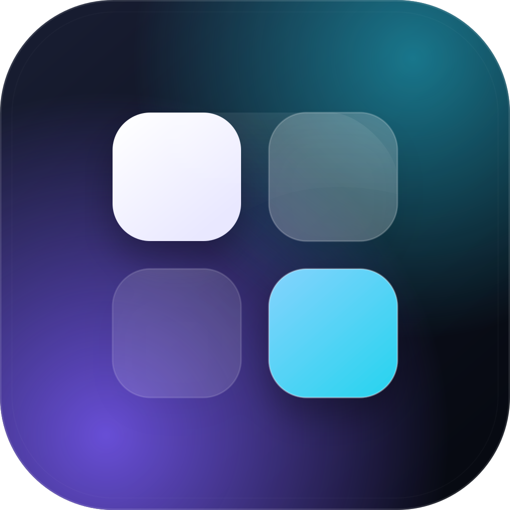
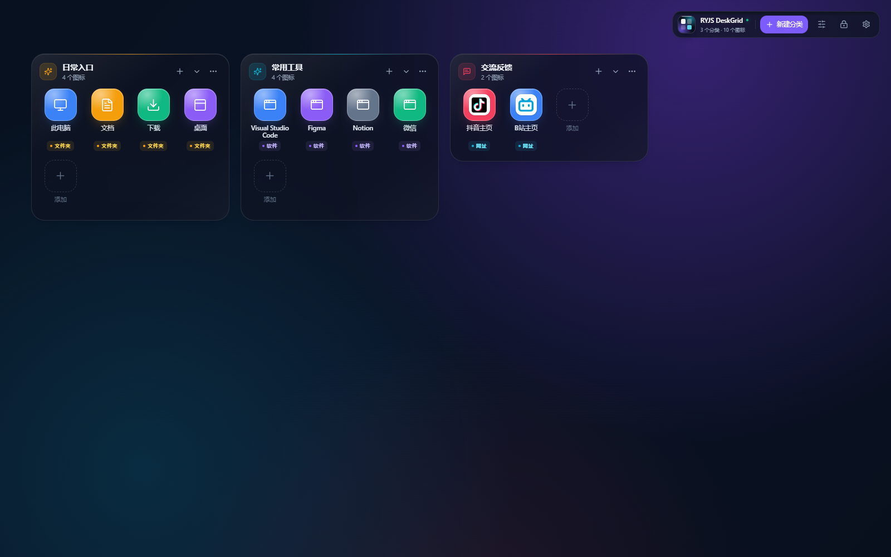
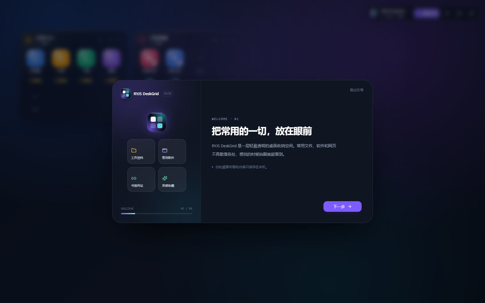
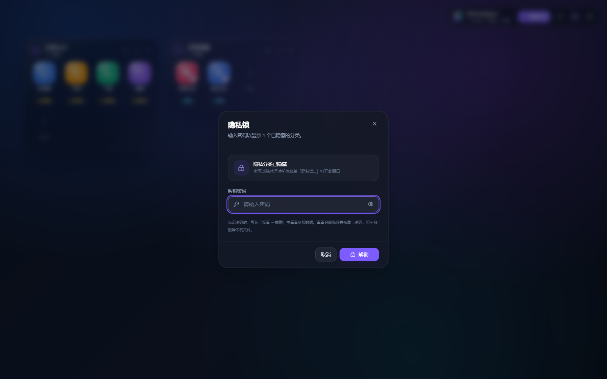
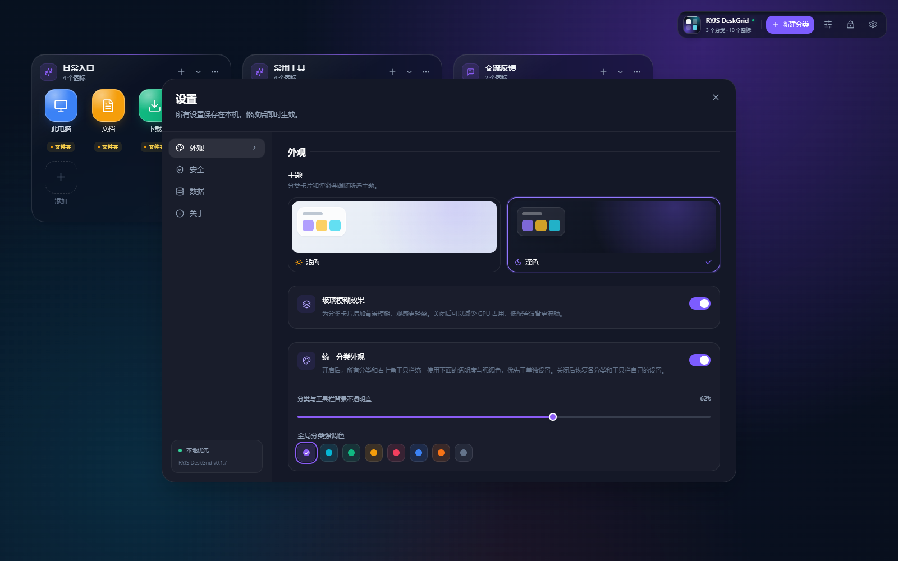

<div align="center">
  
  <h1>RYJS DeskGrid</h1>
  <p><strong>把深层文件、常用软件和网页书签，收进一层轻盈透明的桌面。</strong></p>
  <p>
    <a href="https://github.com/lcyaimer/RYJS-DeskGrid/releases"></a>
    <a href="LICENSE"></a>
    
    
    
  </p>
</div>

> 一个 Windows 桌面收纳工具。窗口与屏幕同尺寸、背景透明，空白区域鼠标穿透，并主动保持在其他窗口下方——玩游戏或全屏工作时不会被它突然挡住。分类卡片可以自由拖动、单独或统一调整透明度，位置自动记忆。



## 下载

| 渠道 | 地址 | 提取码 | 说明 |
| --- | --- | --- | --- |
| **GitHub Releases（推荐）** | [github.com/lcyaimer/RYJS-DeskGrid/releases](https://github.com/lcyaimer/RYJS-DeskGrid/releases) | 无需 | 始终提供最新版本 |
| 夸克网盘 | [pan.quark.cn/s/ce32a112e8ad](https://pan.quark.cn/s/ce32a112e8ad?pwd=hRZG) | `hRZG` | 国内加速 |
| 百度网盘 | [pan.baidu.com/s/1sgmYdf4-mJlKALi9UkUXbw](https://pan.baidu.com/s/1sgmYdf4-mJlKALi9UkUXbw?pwd=4ai5) | `4ai5` | 备用渠道 |

- 系统要求：Windows 10 / 11 x64。
- 安装包为未签名版本，首次运行可能触发 SmartScreen，选择「更多信息 → 仍要运行」即可。
- 首次安装会按需下载 Microsoft WebView2 Runtime（Windows 11 通常已自带）。
- 网盘链接由项目作者维护，若失效或版本滞后，请使用 GitHub Releases。

## 功能

### 桌面层，而不是盖住桌面

- 主界面自动铺满主屏，背景透明，不显示任务栏图标，只保留系统托盘。设置使用独立的普通窗口，可以像其他应用一样在任务栏切换。
- 平时窗口置底，其他应用始终在它上方；切到游戏或全屏应用时不会遮挡操作。
- 只有系统卡和分类卡片所在的矩形区域会接收鼠标，其余空白区域直接穿透到真实桌面。
- 添加、编辑等对话框会悬浮在桌面之上，背后的分类和系统卡保持可见；点击对话框外的桌面或其他应用不会关闭它，可以先切到浏览器复制网址再回来粘贴。设置窗口独立于桌面，不再遮挡分类。菜单与新手引导打开时仍临时占据整个可交互层。

### 分类与图标

- 自由创建、重命名、删除分类；拖动标题栏摆放，重启后记住位置。
- 拖动分类或系统卡时，会与其它卡片的边缘、中心线和 16px 间距对齐，并显示对齐参考线；按住 Alt 可临时关闭吸附。
- 分类背景透明度最低可调到 0%，支持折叠、独立强调色与分类图标识别。
- 设置中提供「统一分类外观」：可全局覆盖透明度和强调色，同时作用于右上角「系统」卡和图标配色，优先级高于单独设置；关闭后恢复各分类、系统卡和图标自己的设置。
- 右上角是一张与分类卡片同风格、可拖动的「系统」卡，集中放置新建分类、透明度、隐私锁和设置；统一外观关闭时，可在卡内单独调整系统卡背景透明度。
- 常用系统目录（此电脑、文档、下载、桌面、图片、音乐、视频）自动使用可识别的专属图标；文件按图片、视频、音频、PDF、压缩包、代码、表格等类型显示不同图标。
- 图标风格支持两种模式：默认「原生图标」读取软件真实 Shell 图标和网站 favicon；「统一文字」使用名称首字，让卡片更整齐。可在设置 → 外观中随时切换。
- 网址书签会自动读取站点 favicon 作为图标，读取失败时回退到名称首字，避免重复的单字图标。
- 类型标记区分为「文件夹 / 文件 / 软件 / 网址」，一眼分辨入口类型。

### 添加入口

- 从任意磁盘选择深层文件或文件夹，单击图标直接打开。
- 新增「添加软件快捷方式」，选择 `.exe`、`.lnk` 等程序文件即可快速启动软件。
- 支持从资源管理器把文件、文件夹、软件快捷方式和 `.url` 网络快捷方式直接拖到分类卡片上松开添加；拖动时会显示目标分类高亮和拖放提示，多文件会一起添加并自动跳过重复项。
- 按自定义路径新建文件或文件夹，可填写初始文件内容。
- 粘贴网址添加网页书签，也可以从 Chrome、Edge、Brave 自动读取书签，或导入浏览器导出的 HTML 书签文件。

### 分类级隐私锁

- 新建/编辑分类时可以开启「隐私分类」，该分类内的入口会随隐私锁一起隐藏。
- 未设置密码时会提示前往设置密码。
- 开启隐私后，可从「系统」卡上的锁按钮或托盘菜单「隐私锁…」隐藏这些分类。
- 隐藏后**不会显示常驻锁屏**，桌面仍然可以正常使用；需要查看时右键托盘图标选择「隐私锁…」，输入密码解锁。
- 密码使用 PBKDF2-SHA256 加盐哈希，仅保存在本机。忘记密码可在「设置 → 数据」重置全部数据。

### 其它

- 五步新手引导。
- 「开机自启」默认开启：登录 Windows 后自动启动并显示桌面分类；可在设置 → 外观关闭。开关直接写入当前用户的启动项，不需要管理员权限。
- 深浅主题；对话框不再使用全屏磨玻璃遮罩，调节透明度时可以直接看到背后的分类和系统卡效果。
- 配置 JSON 导出/导入。
- 本地优先：无账号、无遥测，所有布局数据保存在本机。

## 使用说明

### 第一次启动

1. 启动后会显示 5 步新手引导，点击「开始使用」进入桌面。
2. 默认创建了「日常入口」和「交流反馈」分类；默认书签包含作者的抖音与 B 站主页示例。
3. 每个分类右上角的 `+` 可以添加软件、文件、文件夹、网址、浏览器书签，或新建文件/文件夹。

### 系统卡

右上角是一张与分类卡片同风格、可拖动的「系统」卡：

- **新建分类**：创建分类；在分类编辑窗口中可开启「隐私分类」。
- **透明度**：统一外观关闭时，直接调节系统卡背景不透明度；开启时跟随「统一分类外观」。
- **隐私锁**：锁定或解锁隐私分类。
- **设置**：打开独立的设置窗口（可在任务栏切换），可切换图标风格、统一分类外观、修改密码、导入导出数据。

### 设置窗口

- 点击系统卡上的「设置」或托盘菜单「设置…」，会打开独立的设置窗口；它拥有正常标题栏，可在任务栏最小化、还原和切换。
- 设置修改会立即同步回桌面窗口，无需保存或刷新。
- 「外观」页可以切换图标风格（原生图标 / 统一文字）、调整统一外观，并开启或关闭「开机自启」（默认开启）；「安全」「数据」「关于」页与桌面内的设置内容一致。

### 拖入添加

1. 从资源管理器或桌面拖动文件、文件夹、`.exe`/`.lnk` 快捷方式或 `.url` 网络快捷方式。
2. 把项目移到目标分类卡片上，卡片会出现高亮和「松开添加到…」提示。
3. 松开即可添加；多选会一起加入，已在分类中的同一路径会自动跳过。

### 系统托盘

- **左键单击**托盘图标：显示桌面。
- **右键单击**托盘图标：打开菜单。
  - 显示桌面
  - 隐藏到托盘
  - 隐私锁…（未锁定时锁定隐私分类；已锁定时打开展示密码输入框）
  - 设置…
  - 退出 DeskGrid
- 关闭主界面（Alt+F4）只会隐藏到托盘，不会退出应用；退出请使用托盘菜单。设置窗口关闭不影响桌面常驻。

### 隐私分类

1. 新建或编辑分类时，打开「隐私分类」开关。
2. 若无密码，保存后会引导你设置密码。
3. 点击「系统」卡上的锁按钮，或从托盘菜单选择「隐私锁…」，即可隐藏所有隐私分类。
4. 图标隐藏后不会出现锁屏；通过托盘菜单「隐私锁…」输入密码即可恢复。
5. 忘记密码时，可在「设置 → 数据」重置全部数据。重置会删除布局和密码，但不会删除本机文件。

### 浏览器书签

- 自动检测：进入任一分类的 `+` →「导入浏览器书签」→「自动检测」。
- 文件导入：支持 Chromium 的 `Bookmarks` JSON，以及浏览器「书签管理器 → 导出书签」得到的 HTML 文件。
- 目前自动检测支持 Chrome / Edge / Brave；Firefox 请使用导出的 HTML 文件。

## 截图

| 新手引导 | 隐私锁 |
| --- | --- |
|  |  |

### 设置



## 技术栈

- [Tauri 2](https://tauri.app/) — 原生窗口、置底/穿透、系统托盘与文件能力
- [Vue 3](https://cn.vuejs.org/) + TypeScript — 界面与状态管理
- [Tailwind CSS 3](https://tailwindcss.com/) — 样式系统
- [Lucide](https://lucide.dev/) — 图标

前端通过 `invoke` 调用 Rust 命令完成本机文件操作、浏览器书签读取以及原生窗口区域裁剪，不依赖远程服务。

## 本地开发

### 环境要求

- Node.js 20+
- Rust stable（`rustup`）
- Visual Studio 2022 Build Tools，勾选「使用 C++ 的桌面开发」
- Microsoft Edge WebView2 Runtime

### 启动开发环境

```bash
npm install
npm run tauri:dev
```

只调试前端 UI（浏览器打开，文件选择、置底穿透等原生能力不可用）：

```bash
npm run dev
```

### 类型检查与前端构建

```bash
npm run build:web
```

### 构建安装包

```bash
npm run tauri:build
```

生成的 NSIS 安装包位于：

```
src-tauri/target/release/bundle/nsis/
```

## 自动发布到 GitHub

项目内置了 [`.github/workflows/release.yml`](.github/workflows/release.yml)。推送 `v*` 标签即可自动：

1. 在 `windows-latest` 上安装 Node、Rust（GitHub Runner 自带 MSVC）。
2. 构建 NSIS 安装包。
3. 创建 GitHub Release 草稿并附带安装包。
4. 额外上传 workflow artifact 作为备份。

```bash
git tag v0.2.6
git push origin v0.2.6
```

也可以在 Actions 页面手动运行 workflow 并填写标签。发布前请在 GitHub 上检查 Release 草稿并点击 Publish。若想要完全自动发布，把 workflow 中的 `releaseDraft: true` 改为 `false`。

## 项目结构

```
.
├─ src/
│  ├─ components/          # 分类卡片、图标、系统卡、弹窗、设置、引导、隐私锁、对齐线
│  ├─ stores/desk.ts       # 布局、图标风格、隐私分类和跨窗口同步
│  ├─ lib/
│  │  ├─ platform.ts       # Tauri 命令调用、原生对话框与设置窗口
│  │  ├─ windowLayer.ts    # 空白区域穿透的交互区域上报
│  │  ├─ stateSync.ts      # 桌面窗口与设置窗口之间的状态广播
│  │  ├─ alignment.ts      # 卡片拖动吸附与对齐参考线计算
│  │  ├─ dragDrop.ts       # 资源管理器拖入的状态与命中检测
│  │  ├─ itemIcons.ts      # 系统目录/文件类型图标识别
│  │  ├─ bookmarks.ts      # Netscape 书签 HTML 解析
│  │  ├─ password.ts       # PBKDF2 密码哈希
│  │  └─ overlays.ts       # 桌面窗口内的弹窗状态
│  ├─ SettingsWindow.vue   # 独立设置窗口页面
│  ├─ App.vue
│  └─ style.css
├─ settings.html           # 设置窗口入口页
├─ src-tauri/
│  ├─ src/lib.rs           # 托盘、窗口、拖入路径、Shell 图标、Chromium 书签解析
│  ├─ capabilities/        # Tauri 权限
│  ├─ icons/               # 应用与安装包图标
│  └─ tauri.conf.json
├─ assets/app-icon.svg
├─ .github/workflows/release.yml
└─ README.md
```

## 数据与隐私

- 分类、图标和设置保存在当前 Windows 用户的本地 WebView 存储中，不使用云同步。
- 隐私分类的显示开关仅保存在本机；密码保存为 PBKDF2-SHA256 加盐哈希。
- 设置 → 数据可以导出/导入 JSON 配置备份。备份**不包含密码和隐私锁定状态**。
- 隐私锁只隐藏应用内的分类入口，不是文件加密工具；本机文件本身不会被修改或加密。
- 书签读取完全在本机完成，不会上传浏览器数据。
- 不采集遥测。

## 已知限制

- 当前仅面向 Windows 10/11 x64。
- 空白区域穿透依赖 Windows 原生窗口区域；打开菜单、隐私密码框等临时 UI 时会临时占据全屏交互层，关闭后恢复。设置窗口是独立普通窗口，不参与桌面穿透。
- 分类以像素坐标记忆，更换分辨率后会自动收拢到可见区域内。
- 安装包暂未进行代码签名。
- 自动检测书签仅覆盖 Chromium 系浏览器，Firefox 请导入 HTML。
- 拖入添加需要把项目拖到分类卡片所在区域松开；拖到纯空白桌面不会触发，因为主窗口在空白区域保持鼠标穿透。
- 原生图标模式依赖 Windows Shell 提取图标，权限受限或图标缺失时会回退到通用图标；统一文字模式始终可用。

## AI 参与开发

本项目在开发过程中使用了 AI 编程助手参与部分代码编写、问题排查与文档整理；产品定位、功能取舍和发布决策由项目作者负责。

## 贡献

欢迎提交 Issue 和 Pull Request：[github.com/lcyaimer/RYJS-DeskGrid](https://github.com/lcyaimer/RYJS-DeskGrid)

也可以加入交流群反馈问题：

- 抖音群聊：`781386634796`
- QQ 群：`531908754`

提交前请确保 `npm run build:web` 通过。

## License

[MIT](LICENSE) © 2026 lcyaimer
